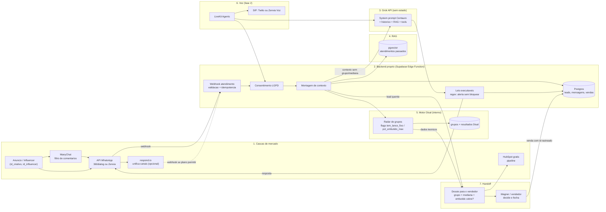

# Arquitetura – Conecta Cortex (MVP)

> Diagrama em Mermaid. **Sintaxe NÃO validada** (sem mermaid-cli e sem instalar nada). Mantive o formato simples (flowchart + subgraph); conferir colando em https://mermaid.live.

## Camadas
1. **Cascas:** ManyChat filtra comentários; a API do WhatsApp (360dialog ou Zenvia) entrega as mensagens; respond.io é opcional (ver `docs/custos.md`); HubSpot grátis só como pipeline.
2. **Backend próprio:** única fonte da verdade. Valida, deduplica, checa consentimento, monta contexto, chama a IA, aplica as leis, envia e registra.
3. **Grok API:** sem estado; recebe system prompt (playbook Centauro), histórico, trechos de RAG e tools.
4. **RAG:** pgvector sobre atendimentos anteriores.
5. **Motor Disal:** usa flags do catálogo (`tem_lance_fixo`, `pct_embutido_max`), nunca número de grupo no código. Roda no backend.
6. **Voz (fase 2):** LiveKit + SIP; exige opt-in específico de biometria de voz.
7. **Handoff:** dossiê interno (grupo, mediana, embutido cobre) vai ao vendedor; o vendedor revela ao cliente na hora certa.

## Decisões de desenho
- **A IA não recebe grupo, mediana nem embutido** para o texto ao cliente. Ela só recebe um sinal de escassez genérico (ex.: "há poucos grupos maduros na faixa"). O dado técnico segue direto para o dossiê. Isso "segura o cartão" por construção, além da regra regex. **A confirmar com o Wagner.**
- Leis são alerta, não bloqueio; Wagner arbitra pelo registro em `alertas_compliance`.
- Venda carrega `id_criativo`, `id_influencer`, `id_grupo` (laço criativo → venda → feedback).
