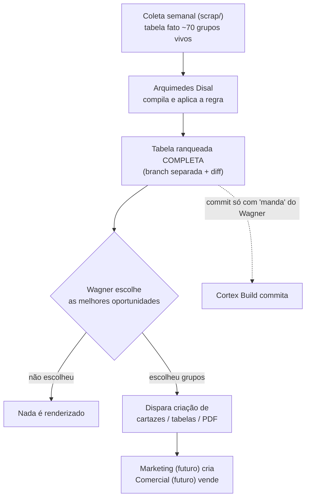

# Fluxo em cascata

Regra: **só se renderiza cartaz/tabela de grupo que o Wagner escolheu**. Evita gerar PDF de grupo que não será usado.

*(Mermaid não validado: sem mermaid-cli. Conferir em https://mermaid.live.)*

## Passos
1. Arquimedes entrega a tabela ranqueada completa (todos os grupos vivos, não só o Top 5).
2. Wagner escolhe as melhores oportunidades (limites de entrada, ex.: 10 a 24/11).
3. Só então dispara cartaz/tabela, para os grupos escolhidos.
4. Commit da tabela: só o Cortex Build, só com aprovação do Wagner.

Validade: dado com mais de 8 dias de coleta sai `desatualizada` (solver v1.1); cartaz de grupo com dado vencido deve esperar a coleta seguinte.
